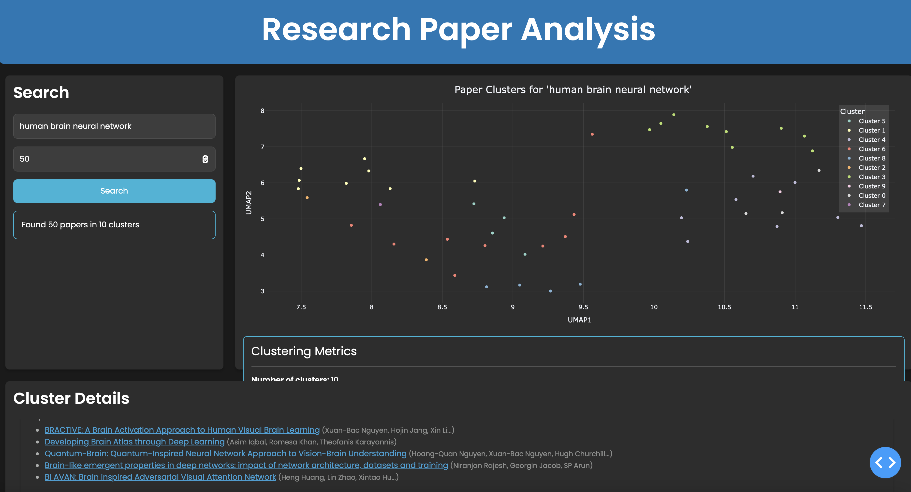
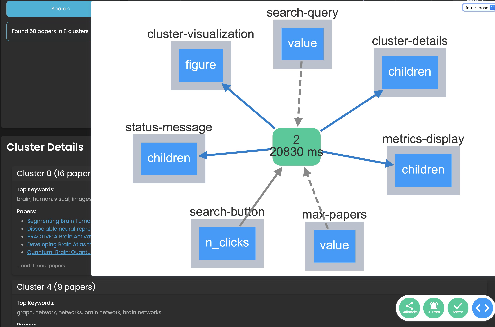
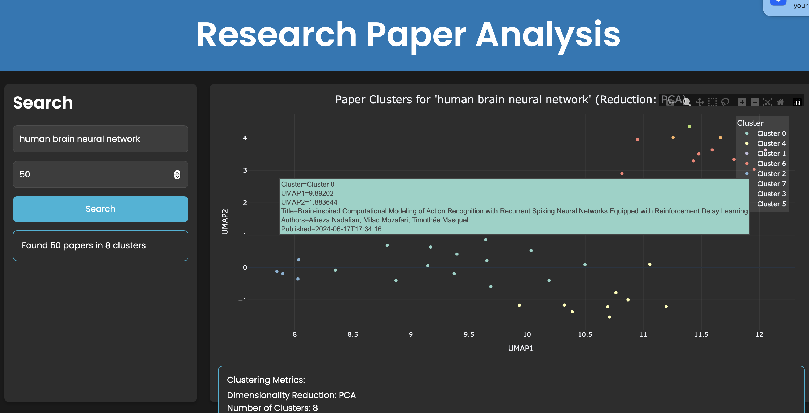

# SynSearch

## Overview
SynSearch is a sophisticated Python-based research paper analysis system that combines advanced NLP techniques, clustering algorithms, and scientific text processing. The project aims to help researchers effectively analyze and summarize large collections of scientific literature.



## 📚 Table of Contents
1. [Core Features](#core-features)
2. [System Architecture](#system-architecture)
3. [Installation](#installation)
4. [Configuration](#configuration)
5. [Usage Guide](#usage-guide)
6. [API Reference](#api-reference)
7. [Development](#development)
8. [Testing](#testing)
9. [Performance Optimization](#performance-optimization)
10. [Troubleshooting](#troubleshooting)

## Core Features

### 📖 Document Processing
- **Multi-Dataset Support**
  - XL-Sum dataset integration
  - ScisummNet dataset processing
  - Custom dataset handling capabilities

### 🧠 Advanced Text Processing
- **Domain-Specific Processing**
  - Scientific text preprocessing
  - Legal document handling
  - Metadata extraction
  - URL and special character normalization

### 🔄 Data Pipeline
- **Robust Data Loading**
  - Batch processing support
  - Progress tracking
  - Automatic validation
  - Performance optimization

### 🎯 Clustering & Analysis
- **Dynamic Clustering**
  - HDBSCAN implementation
  - Silhouette score calculation
  - Cluster quality metrics
  - Adaptive cluster size

### 📊 Summarization
- **Hybrid Summarization System**
  - Multiple summarization styles:
    - Technical summaries
    - Concise overviews
    - Detailed analyses
  - Batch processing support
  - GPU acceleration

## System Architecture

### Directory Structure
```
synsearch/
├── src/
│   ├── api/                 # API integrations
│   ├── preprocessing/       # Text preprocessing
│   ├── clustering/          # Clustering algorithms
│   ├── summarization/       # Summary generation
│   ├── utils/              # Utility functions
│   └── visualization/       # Visualization tools
├── tests/                  # Test suite
├── config/                 # Configuration files
├── data/                   # Dataset storage
├── logs/                   # Log files
├── cache/                  # Cache storage
└── outputs/               # Generated outputs
```

### Key Components

#### 1. Data Management
- `DataLoader`: Handles dataset loading and validation
- `DataPreparator`: Prepares and preprocesses text data
- `DataValidator`: Ensures data quality and format

#### 2. Text Processing
- `TextPreprocessor`: Handles text cleaning and normalization
- `DomainAgnosticPreprocessor`: Generic text preprocessing
- `EnhancedDataLoader`: Optimized data loading

#### 3. Analysis
- `ClusterManager`: Manages document clustering
- `EnhancedEmbeddingGenerator`: Generates text embeddings
- `HybridSummarizer`: Multi-style text summarization

## Installation

### Prerequisites
- Python 3.8 or higher
- CUDA-compatible GPU (optional)
- 8GB RAM minimum (16GB recommended)

### Setup Steps
```bash
# Clone repository
git clone https://github.com/stochastic-sisyphus/synsearch.git
cd synsearch

# Create virtual environment
python -m venv venv
source venv/bin/activate  # On Windows: venv\Scripts\activate

# Install dependencies
pip install -r requirements.txt

# Download required datasets
make download-data

# Initialize system
python -m src.initialization
```

## Configuration

### Basic Configuration (config/config.yaml)

> **Note:** Replace placeholder paths (indicated with `<...>`) with your actual directory paths.

```yaml
data:
  input_path: "<path_to_input_data>"        # e.g., "data/raw"
  output_path: "<path_to_output_data>"      # e.g., "data/processed"
  scisummnet_path: "<path_to_scisummnet>"   # e.g., "data/scisummnet"
  batch_size: 32

preprocessing:
  min_length: 100
  max_length: 1000
  validation:
    min_words: 50

embedding:
  model_name: "bert-base-uncased"
  dimension: 768
  batch_size: 32
  max_seq_length: 512
  device: "cuda"

clustering:
  algorithm: "hdbscan"
  min_cluster_size: 5
  min_samples: 3
  metric: "euclidean"

summarization:
  model_name: "t5-base"
  max_length: 150
  min_length: 50
  batch_size: 16
```

### Advanced Settings
- Performance optimization
- Cache management
- Logging configuration
- Visualization options

## Usage Guide

### Basic Usage
```python
from src.main import main

# Run complete pipeline
main()
```

### Custom Pipeline
```python
from src.api.arxiv_api import ArxivAPI
from src.preprocessing.domain_agnostic_preprocessor import DomainAgnosticPreprocessor
from src.clustering.cluster_manager import ClusterManager

# Initialize components
api = ArxivAPI()
preprocessor = DomainAgnosticPreprocessor()
cluster_manager = ClusterManager(config)

# Process papers
papers = api.search("quantum computing", max_results=50)
processed_texts = preprocessor.preprocess_texts([p['text'] for p in papers])
clusters, metrics = cluster_manager.perform_clustering(processed_texts)
```

## Development

### Environment Setup
- Use Python 3.8+ virtual environment
- Install development dependencies: `pip install -r requirements-dev.txt`
- Setup pre-commit hooks: `pre-commit install`

### Code Style
- Follow PEP 8 guidelines
- Use type hints
- Document using Google docstring format

### Contributing
1. Fork the repository
2. Create feature branch
3. Add tests
4. Submit pull request

## Testing

### Running Tests
```bash
# Run all tests
pytest tests/

# Run specific test category
pytest tests/test_preprocessor.py
pytest tests/test_clustering.py
```

### Test Coverage
- Unit tests for all components
- Integration tests for pipelines
- Performance benchmarks

## Performance Optimization

### Automatic Optimization
- Batch size optimization
- Worker count adjustment
- GPU utilization
- Memory management

### Caching System
- Embedding cache
- Dataset cache
- Results cache

## Troubleshooting

### Common Issues
1. Memory errors
   - Reduce batch size
   - Enable disk caching
2. GPU errors
   - Check CUDA installation
   - Reduce model size
3. Dataset loading issues
   - Verify paths
   - Check file permissions


# Demo

## Demo Screenshots







### Logging
- Logs stored in `logs/synsearch.log`
- Debug level logging available
- Performance metrics tracking

## License
MIT, the usual

## Contributors
- @stochastic-sisyphus

## Contact
dont
lol jk 
do if you'd like
